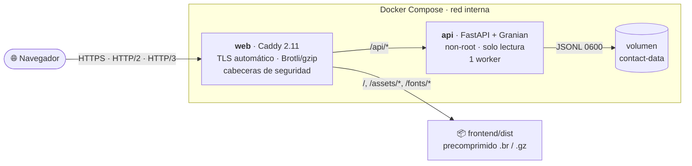
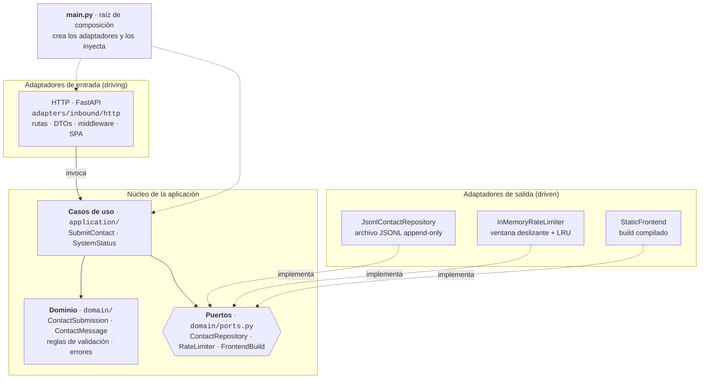
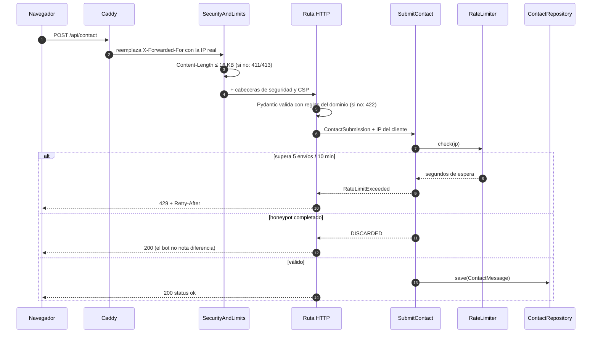
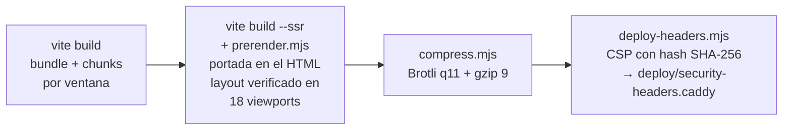
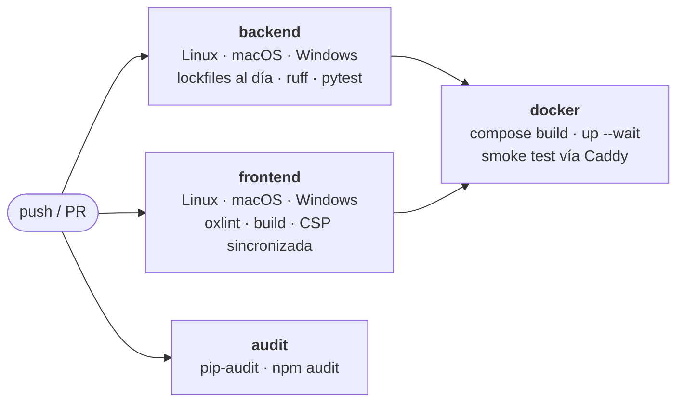

<div align="center">

# Portfolio OS · Maximiliano Andrés

**Portafolio interactivo con forma de sistema operativo de escritorio.** Tiene ventanas arrastrables, terminal, paleta de comandos, logros y un tour guiado. También ofrece una vista técnica (TI) y otra en lenguaje de negocio para reclutadores (RRHH).

[](https://github.com/maximiliano-andres/new_porfolio/actions/workflows/ci.yml)


[Arquitectura](#-arquitectura) · [Backend hexagonal](#-backend-arquitectura-hexagonal) · [Estructura](#-estructura-del-proyecto) · [Inicio rápido](#-inicio-rápido) · [Calidad y CI](#-calidad-y-ci) · [Seguridad](#-seguridad)

</div>

---

## ✨ Puntos destacados

| | |
|---|---|
| 🏛️ **Arquitectura hexagonal** | El dominio y los casos de uso no dependen de FastAPI ni del disco. Cambiar el almacenamiento (JSONL → PostgreSQL) o el rate limiter (memoria → Redis) solo requiere un adaptador nuevo. |
| ⚡ **Rendimiento** | La portada llega pre-renderizada en el HTML y se pinta antes de cargar el JavaScript. El layout se verifica en 18 tamaños de pantalla durante el build. Los assets se sirven precomprimidos con Brotli (526 KB → 137 KB) y hay code-splitting por ventana. |
| 🦀 **Herramientas en Rust** | Granian como servidor ASGI, Rolldown/Vite 8 como bundler, oxlint, ruff y uv. |
| 🔒 **Seguridad** | La CSP usa hashes SHA-256 y nunca `'unsafe-inline'`. Hay rate limit por IP que no se puede falsificar, honeypot anti-bots, contenedores non-root con sistema de archivos de solo lectura y dependencias verificadas por hash. |
| ✅ **Calidad** | 87 tests (unitarios + integración) y CI en Linux, macOS y Windows con build Docker y smoke test. Hay auditorías de dependencias (npm y pip) y lint con cero advertencias. |
| 🐳 **Producción** | Un `docker compose up` levanta Caddy (HTTPS automático, HTTP/2 y HTTP/3) con FastAPI detrás, en una red interna y con healthchecks. |

---

## 🧰 Stack tecnológico

| Capa | Tecnologías |
|---|---|
| **Frontend** | React 18 · Vite 8 (Rolldown) · Tailwind CSS 4 · Framer Motion (`LazyMotion`) · Lucide · Service Worker |
| **Backend** | Python 3.14 · FastAPI · Pydantic v2 · Granian (servidor HTTP en Rust, uvloop) |
| **Infraestructura** | Docker multi-stage · Docker Compose · Caddy 2.11 (TLS automático, HTTP/3, Brotli) |
| **Calidad** | pytest · ruff · oxlint · pip-audit · npm audit · GitHub Actions (matriz de 3 SO) |
| **Dependencias** | uv con lockfiles universales verificados por hash (`--require-hashes`) |

---

## 🏗️ Arquitectura

En producción, Caddy actúa como punto de entrada único. Sirve los archivos estáticos y solo envía `/api/*` a FastAPI, que no tiene puertos publicados.



---

## 🧩 Backend: arquitectura hexagonal

El backend sigue el patrón **Ports & Adapters**. Las dependencias siempre apuntan hacia el dominio. Ninguna capa interior conoce a las exteriores.



| Capa | Responsabilidad | Depende de |
|---|---|---|
| `domain/` | Entidades, reglas de negocio (sanitización de texto, validación de email, límites) y **puertos** (interfaces `Protocol`) | Nada: Python puro |
| `application/` | Casos de uso que orquestan el dominio a través de los puertos | `domain/` |
| `adapters/inbound/http/` | Traduce HTTP ↔ casos de uso y errores de dominio ↔ códigos HTTP (429, 500) | `application/`, `domain/`, FastAPI |
| `adapters/outbound/` | Implementaciones concretas de los puertos (archivo, memoria) | `domain/` |
| `config.py` · `main.py` | Configuración por variables de entorno y ensamblado de la app (`create_app(settings)`) | Todas |

**Por qué escala:** para guardar los mensajes en PostgreSQL o enviarlos por email basta con crear `adapters/outbound/postgres_contact_repository.py`, que implemente `save()` e `is_writable()`, y cambiar una línea en `main.py`. El dominio, los casos de uso y sus tests no cambian.

### Flujo de un mensaje de contacto



---

## 🎨 Frontend

La interfaz es una SPA en React organizada por responsabilidad. Las llamadas HTTP están aisladas en `services/` (el adaptador del cliente), así que los componentes no conocen URLs ni formatos de transporte.

| Carpeta | Contenido |
|---|---|
| `src/app/` | Shell de la aplicación: `PolyglotPortfolio.jsx` (gestor de ventanas), contextos, motor de layout y `ErrorBoundary` |
| `src/components/` | Piezas de UI reutilizables: barra superior, dock, ventana flotante, hero, fondo de circuitos |
| `src/windows/` | Contenido de cada ventana, cargado bajo demanda (`lazy.js`): perfil técnico, RRHH, terminal, simulador, logros, contacto |
| `src/overlays/` | Capas sobre el escritorio: paleta de comandos, tour guiado, menú del núcleo, notificaciones |
| `src/services/` | Adaptadores HTTP hacia el backend (`contactApi.js`) |
| `src/data/` | Contenido del portafolio (proyectos, experiencia, competencias) separado de la presentación |
| `src/lib/` | Utilidades: store del circuito, sonido, almacenamiento, focus trap, entorno |
| `src/styles/` | Tailwind 4 (tema en CSS), fuentes autoalojadas y tokens de color |

### Pipeline de build



---

## 📁 Estructura del proyecto

```text
.
├── backend/                         # API · Python 3.14 + FastAPI (hexagonal)
│   ├── app/
│   │   ├── domain/                  # entidades, reglas y puertos (sin dependencias)
│   │   │   ├── contact.py
│   │   │   ├── errors.py
│   │   │   └── ports.py
│   │   ├── application/             # casos de uso
│   │   │   ├── submit_contact.py
│   │   │   └── system_status.py
│   │   ├── adapters/
│   │   │   ├── inbound/http/        # FastAPI: rutas, DTOs, seguridad, proxy, SPA
│   │   │   └── outbound/            # repositorio JSONL, rate limiter en memoria
│   │   ├── config.py                # Settings desde variables de entorno
│   │   ├── main.py                  # raíz de composición · create_app()
│   │   └── __main__.py              # python -m app
│   ├── tests/
│   │   ├── unit/                    # dominio, casos de uso (dobles de prueba), adaptadores
│   │   └── integration/             # API HTTP de punta a punta
│   ├── requirements.txt / .lock     # dependencias directas / lock con hashes
│   ├── requirements-dev.txt / .lock
│   ├── pytest.ini
│   └── ruff.toml
├── frontend/                        # SPA · React 18 + Vite 8 + Tailwind 4
│   ├── src/
│   │   ├── app/  components/  windows/  overlays/
│   │   ├── services/  data/  lib/  styles/
│   │   ├── main.jsx                 # punto de entrada del navegador
│   │   └── prerender.jsx            # punto de entrada SSR (solo build)
│   ├── public/                      # fuentes, imágenes, service worker, robots.txt
│   ├── scripts/                     # post-build: prerender, compresión, CSP para Caddy
│   ├── index.html
│   ├── vite.config.js
│   └── package.json
├── config/
│   └── security-headers.json        # política HTTP única (FastAPI + Caddy)
├── deploy/
│   ├── Caddyfile                    # punto de entrada de producción
│   └── security-headers.caddy       # generado en cada build
├── docs/auditoria/                  # auditorías técnicas y propuestas (histórico)
├── .github/workflows/ci.yml         # CI: tests, lint, auditoría, build, Docker
├── Dockerfile                       # multi-stage: frontend → api-deps → api / web
├── docker-compose.yml
└── .env.example
```

---

## 🚀 Inicio rápido

### Opción A · Docker (recomendado)

Requiere Docker Desktop (en Windows, con WSL 2).

```bash
cp .env.example .env              # en producción: SITE_ADDRESS=tudominio.cl
docker compose up -d --build      # → http://localhost   (o https://tudominio.cl)
```

```bash
docker compose ps                                          # estado y healthchecks
docker compose logs -f web                                 # logs de acceso (Caddy)
docker compose exec api cat /data/contact_messages.jsonl   # mensajes recibidos
```

> Si el puerto 80 está ocupado, define `HTTP_PORT=8080` en `.env`.

### Opción B · Desarrollo local

**Requisitos:** Node.js 20.19+ o 22.12+ y Python 3.13+.

**1. Backend** (terminal 1)

```bash
cd backend
python -m venv .venv
source .venv/bin/activate              # Windows PowerShell: .venv\Scripts\Activate.ps1
pip install --require-hashes -r requirements-dev.lock

APP_ENV=development python -m app      # → http://localhost:8000  (recarga automática + /docs)
# Windows PowerShell:  $env:APP_ENV="development"; python -m app
```

**2. Frontend** (terminal 2)

```bash
cd frontend
npm install
npm run dev                            # → http://localhost:5173  (proxy de /api → :8000)
```

**Producción sin Docker:** ejecuta `npm run build` en `frontend/` y luego `python -m app` en `backend/`. FastAPI sirve la API y el build compilado desde `http://localhost:8000`. Opcionalmente, Caddy puede ir delante (ver `deploy/Caddyfile`).

---

## ✅ Calidad y CI

```bash
# backend/
python -m pytest          # 87 tests: unitarios (dominio, casos de uso, adaptadores) + integración HTTP
ruff check .              # lint Python (Rust)

# frontend/
npm run lint              # oxlint (Rust), cero advertencias permitidas
npm run build             # build completo: bundle + prerender + Brotli/gzip + CSP
```

Cada push y pull request ejecuta el pipeline completo, y cualquier fallo bloquea el merge:



---

## 🔒 Seguridad

- **Cabeceras:** Content-Security-Policy, `X-Content-Type-Options`, `X-Frame-Options`, `Referrer-Policy`, `Permissions-Policy` y COOP, más HSTS opcional. Se definen una sola vez en `config/security-headers.json` y las aplican tanto FastAPI como Caddy.
- **CSP estricta:** el único script en línea (el de la portada pre-renderizada) se autoriza por su hash SHA-256, nunca con `'unsafe-inline'`.
- **API de contacto:**
  - Validación con límites: nombre 100, email 254 y mensaje 5000 caracteres.
  - Cuerpo máximo de 16 KB, rechazado antes de leerlo.
  - Eliminación de caracteres de control y bidi.
  - Honeypot contra bots.
  - Rate limit de 5 envíos cada 10 minutos por IP, que responde `429` con `Retry-After`.
- **IP real del cliente:** se toma del último salto no confiable de `X-Forwarded-For`, así que falsificar la cabecera no evita el límite.
- **Datos personales:** se guardan con permisos `0600` y nunca se escriben en el log del servidor.
- **Contenedores:** usuario non-root, sistema de archivos de solo lectura, `cap_drop: ALL`, `no-new-privileges` y límites de CPU y memoria.
- **Supply chain:** dependencias Python instaladas con `--require-hashes` y auditorías automáticas en el CI.
- **Archivos estáticos:** solo se sirven tipos conocidos, con protección contra path traversal. Un asset inexistente responde `404`, nunca el HTML.

---

## ⚙️ Configuración

Variables de entorno del backend. Todas son opcionales.

| Variable | Por defecto | Uso |
|---|---|---|
| `APP_ENV` | `production` | `development` habilita recarga automática, `/docs` y CORS para Vite |
| `HOST` / `PORT` | `127.0.0.1` / `8000` | Usa `0.0.0.0` solo detrás de un proxy o firewall |
| `CORS_ORIGINS` | — | Orígenes extra, separados por coma |
| `TRUST_PROXY` | — | `1` detrás de un proxy confiable |
| `FORWARDED_ALLOW_IPS` | `127.0.0.1` | Proxies confiables para `X-Forwarded-For` (`*` solo si el proxy sobrescribe la cabecera, como Caddy) |
| `CLIENT_IP_HEADER` | — | Ej. `cf-connecting-ip` detrás de Cloudflare (requiere `TRUST_PROXY=1`) |
| `ENABLE_HSTS` | — | `1` cuando el sitio se sirve solo por HTTPS |
| `CONTACT_LOG` | `backend/contact_messages.jsonl` | Archivo de mensajes (en Docker: `/data/…`, volumen persistente) |
| `FRONTEND_DIST` | `frontend/dist` | Build compilado del frontend |
| `SECURITY_HEADERS_FILE` | `config/security-headers.json` | Política de cabeceras HTTP |

Variables de Docker Compose (`.env`): `SITE_ADDRESS`, `HTTP_PORT`, `HTTPS_PORT` y `ENABLE_HSTS`. Ver [`.env.example`](.env.example).

---

## 🧠 Decisiones técnicas

- **Un solo worker en la API:** el rate limit vive en memoria, y con N workers el límite real sería N veces mayor. El tráfico pesado (HTML, JS, fuentes) lo atiende Caddy. Para escalar horizontalmente basta con un adaptador `RateLimiter` sobre Redis.
- **Middleware ASGI puro en vez de `BaseHTTPMiddleware`:** aumentó en un ~25 % el throughput de `/api/status` (medido: 1 839 → 2 467 req/s en Granian).
- **Almacenamiento JSONL:** es suficiente para un portafolio, sin una base de datos que mantener, y es reemplazable gracias al puerto `ContactRepository`.
- **Fuentes autoalojadas y portada pre-renderizada:** evitan depender de terceros y mejoran el primer pintado en redes lentas.

Las auditorías técnicas completas (rendimiento, seguridad y evaluación de herramientas en Rust) están en [`docs/auditoria/`](docs/auditoria/).

---

## 👤 Autor

**Maximiliano Andrés**

[](https://github.com/maximiliano-andres)
[](https://www.linkedin.com/in/maximiliano-andres)
[](mailto:max.andres1995@outlook.com)
