<div align="center">


# Polyglot Core · Portafolio de Maximiliano Caniullan

**Un portafolio con forma de escritorio de computador. Muestra el perfil de un desarrollador backend en lenguaje técnico o en lenguaje de negocio, según quien lo visite.**

El visitante abre ventanas, usa una terminal, prueba un simulador y gana insignias mientras recorre la trayectoria, los proyectos y los resultados medibles del autor. Detrás hay un backend en Python con arquitectura hexagonal y un despliegue en contenedores pensado para producción.

[](frontend/package.json)
[](frontend/package.json)
[](frontend/package.json)
[](Dockerfile)
[](backend/requirements.txt)
[](docker-compose.yml)

[](https://github.com/maximiliano-andres/new_porfolio/actions/workflows/ci.yml)


[En 30 segundos](#-el-proyecto-en-30-segundos) · [Capturas](#-capturas) · [Funcionalidades](#-funcionalidades) · [Tecnología](#-tecnología) · [Diagramas](#️-mapas-del-sistema) · [Instalación](#-instalación) · [Manual de uso](#-manual-de-uso) · [Seguridad](#-seguridad) · [FAQ](#-preguntas-frecuentes)

</div>

---

## 🧭 El proyecto en 30 segundos

| | |
|---|---|
| **El problema** | Un CV en PDF no muestra cómo trabaja un desarrollador. A un reclutador le cuesta entender los términos técnicos, y a un líder técnico le faltan detalles. |
| **La solución** | Un sitio web interactivo que presenta el mismo perfil de dos formas: **Perfil TI** (tecnologías, arquitectura y métricas) y **Perfil RRHH** (lenguaje de negocio, sin tecnicismos). Se cambia con un clic. |
| **Para quién** | Reclutadores, equipos de RRHH y líderes técnicos que evalúan al candidato. También sirve como referencia para desarrolladores que buscan un ejemplo de arquitectura limpia. |
| **Seguridad** | No pide cuentas ni contraseñas. El único dato que recibe es el formulario de contacto, que se valida, se limita contra el spam y se guarda en un archivo privado del servidor. |
| **Alcance** | 11 ventanas de contenido, terminal con comandos, simulador, 13 insignias, tour guiado y formulario de contacto. La API tiene 2 endpoints: estado y contacto. |

> [!IMPORTANT]
> **Es un sitio público de solo lectura, sin cuentas de usuario.** Cualquier persona puede visitarlo sin registrarse. Las preferencias del visitante (perfil elegido, insignias, sonido) se guardan en su propio navegador y no viajan al servidor. Los mensajes de contacto quedan en un archivo del servidor, y solo puede leerlos quien administra ese servidor. No hay un panel web para verlos.

---

## 📸 Capturas

<table>
  <tr>
    <td width="50%">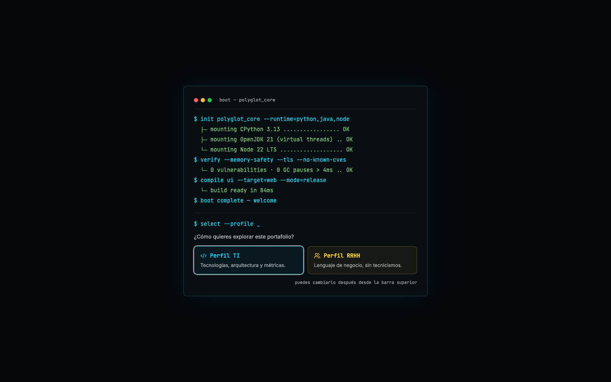<br/><b>Inicio</b>: el visitante elige cómo leer el portafolio.</td>
    <td width="50%">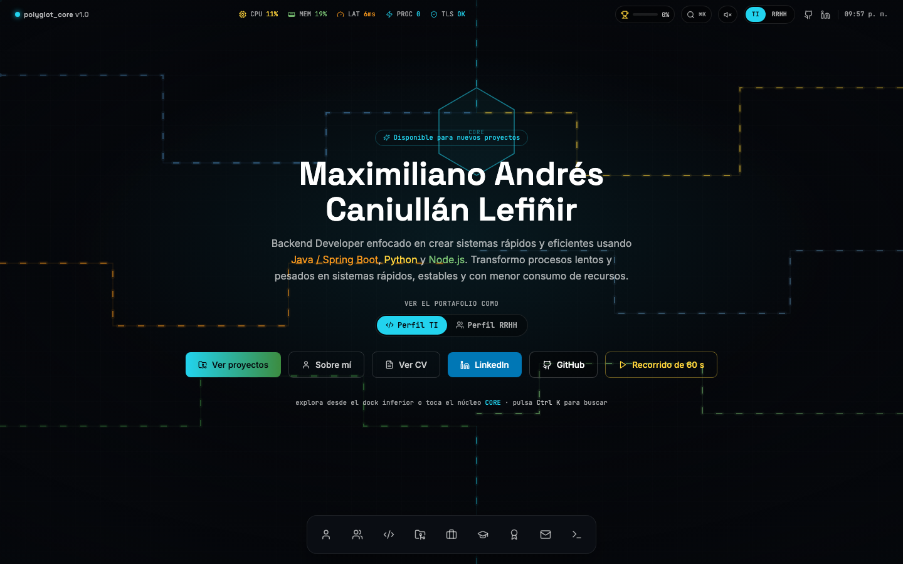<br/><b>Escritorio</b>: portada, accesos rápidos y dock inferior.</td>
  </tr>
  <tr>
    <td>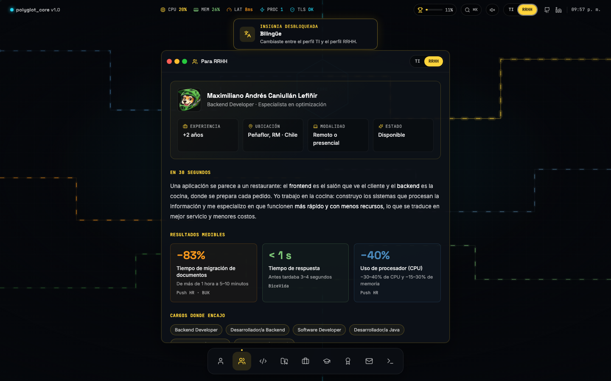<br/><b>Ficha para RRHH</b>: resultados medibles en lenguaje de negocio.</td>
    <td>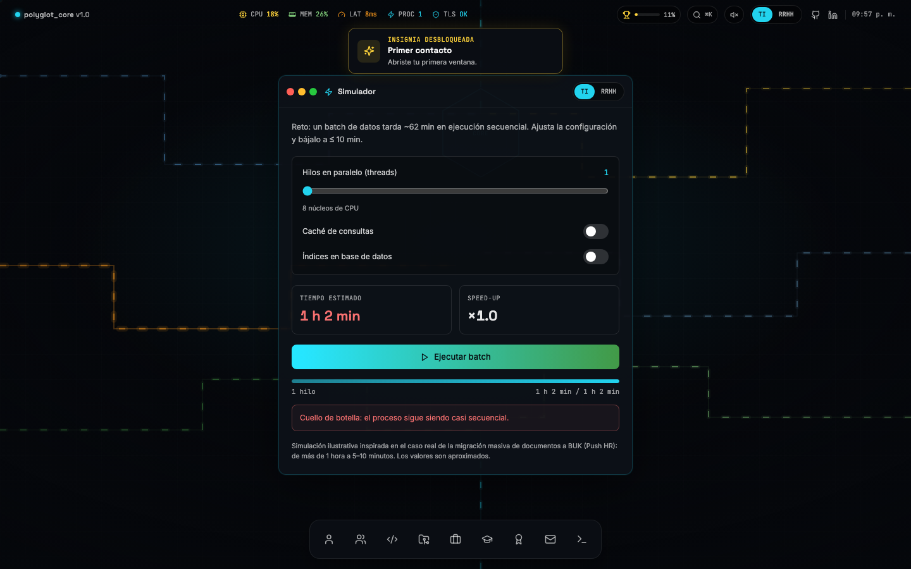<br/><b>Simulador</b>: muestra cómo influyen los hilos, la caché y los índices.</td>
  </tr>
  <tr>
    <td>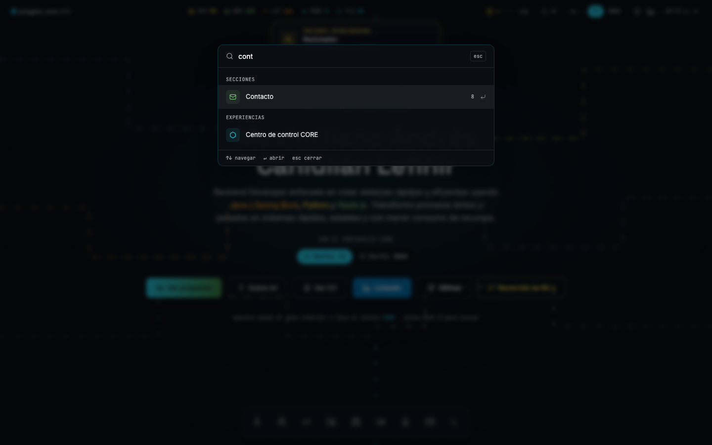<br/><b>Paleta de comandos</b>: búsqueda rápida con <kbd>Ctrl</kbd> + <kbd>K</kbd>.</td>
    <td>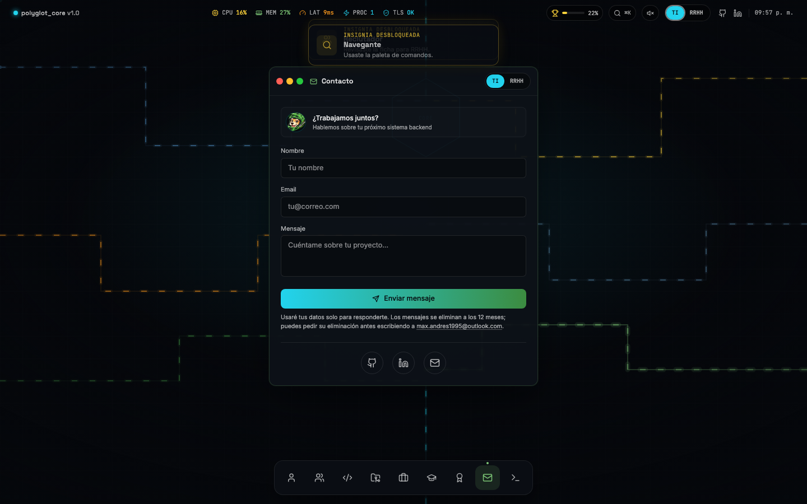<br/><b>Contacto</b>: formulario con validación y protección anti-spam.</td>
  </tr>
  <tr>
    <td>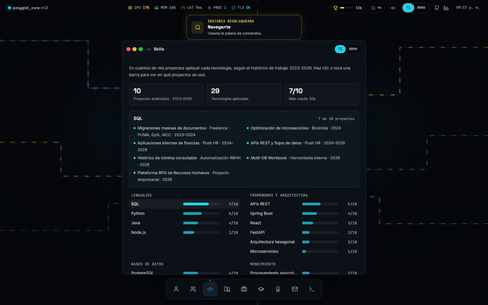<br/><b>Skills</b>: en cuántos proyectos del histórico se usó cada tecnología.</td>
    <td></td>
  </tr>
</table>

<sub>Capturas generadas con Playwright sobre el build de producción (1440×900). El formulario de contacto tiene datos ficticios y no se envió.</sub>

---

## ✨ Funcionalidades

### Para el usuario de negocio

| | Funcionalidad | Qué permite hacer |
|---|---|---|
| 👥 | **Dos perfiles de lectura** | Ver el mismo contenido explicado para TI o para RRHH. Por ejemplo, en RRHH «Skills» pasa a llamarse «Competencias» y «Proyectos» pasa a «Logros». |
| 🔗 | **Enlace directo para reclutadores** | Compartir un enlace que abre el perfil RRHH de inmediato, añadiendo `?vista=rrhh` a la dirección. |
| 📊 | **Ficha para RRHH** | Ver en una pantalla la experiencia, la ubicación, la modalidad, los resultados medibles (por ejemplo, «un proceso de más de 1 hora reducido a 5–10 minutos») y los cargos donde encaja. |
| ▶️ | **Recorrido de 60 segundos** | Ver un resumen narrado que abre las ventanas clave por sí solo, sin tener que explorar. |
| 🧭 | **Tour por la interfaz** | Recibir una guía de 5 pasos la primera vez que se entra al sitio. |
| ⚡ | **Simulador** | Probar cómo un proceso de unos 62 minutos baja de tiempo al ajustar hilos, caché e índices. Es un modelo ilustrativo inspirado en un caso real. |
| 🏆 | **Insignias y progreso** | Ver qué secciones faltan por revisar. Hay 13 insignias, como «Reclutador» o «Explorador». |
| 📄 | **Mi CV** | Ver el CV completo (2 páginas) en cualquier navegador o celular, descargarlo en PDF o abrirlo en otra pestaña. Se abre desde **Ver CV** en la portada, la ficha RRHH, `Ctrl/⌘ + K` o el comando `cv` de la terminal. |
| ✉️ | **Contacto** | Enviar un mensaje al autor sin salir del sitio y recibir confirmación inmediata. Bajo el botón se informa para qué se usan los datos y cuánto tiempo se guardan. |

### Para el perfil técnico

| | Funcionalidad | Detalle técnico |
|---|---|---|
| 📈 | **Skills basado en evidencia** | En lugar de porcentajes autoevaluados, un gráfico cuenta en cuántos proyectos del histórico (2023–2026) se usó cada tecnología. Los conteos se calculan desde `PROJECT_HISTORY`, y se navega con flechas (radiogroup accesible). |
| 🪟 | **Gestor de ventanas** | Ventanas arrastrables, minimizables y maximizables, con orden z, motor de layout responsivo y atajos `1`–`9` y `Esc`. |
| ⌨️ | **Paleta de comandos y terminal** | Búsqueda sin distinguir acentos (`Ctrl/⌘ + K`) y una terminal con `help`, `ls`, `open <sección>`, `neofetch` y otros comandos. |
| 🧩 | **Code-splitting por ventana** | Cada grupo de ventanas es un chunk `lazy()` que se precarga al pasar el cursor por el dock o cuando el navegador queda inactivo. |
| 🚀 | **Portada pre-renderizada** | El build hace SSR de la portada dentro de `index.html` y verifica el layout en 18 viewports, así que el primer pintado no espera a JavaScript. |
| 📦 | **Assets precomprimidos** | Archivos Brotli (calidad 11) y gzip (nivel 9) generados en el build (≈560 KB → ≈150 KB en Brotli); no se escribe la variante si no es más chica que el original. FastAPI y Caddy los sirven según `Accept-Encoding`. |
| 📴 | **Service Worker** | Usa cache-first para assets con hash, fuentes e imágenes, y network-first (con timeout de 3 s y navigation preload) para las páginas. Solo guarda la portada HTML: abrir el PDF del CV nunca reemplaza la copia offline. El build estampa un hash en `sw.js`, así que cada deploy renueva las cachés. No intercepta `/api/*`. |
| 🏛️ | **API hexagonal** | Dominio y casos de uso en Python puro. Los adaptadores HTTP, de archivo JSONL y de rate limiter implementan puertos `Protocol`. |
| 🩺 | **Readiness probe** | `GET /api/status` devuelve `503` si no se puede escribir el archivo de mensajes, si queda poco disco (`MIN_FREE_DISK_MB`) o si falta el build en producción. Lo usan los healthchecks de Docker. |

---

## 🧰 Tecnología

| Capa | Tecnología | Uso en el proyecto |
|---|---|---|
| Interfaz | React 18.3.1 · Framer Motion 11.18 (`LazyMotion`) · Lucide 0.424 | Escritorio, ventanas, animaciones e íconos |
| Estilos | Tailwind CSS 4.3.3 · fuentes autoalojadas (Inter, Space Grotesk, JetBrains Mono) | Tema en CSS, sin peticiones a terceros |
| Build | Vite 8.3.5 (Rolldown 1.2) · scripts Node propios | Bundle, SSR de la portada, compresión y CSP para Caddy |
| API | Python 3.14 · FastAPI 0.141.1 · Pydantic 2.14 · Starlette 1.10 | Endpoints `/api/status` y `/api/contact` |
| Servidor ASGI | Granian 2.8.7 (Rust) con uvloop | 1 worker en producción y recarga automática en desarrollo |
| Proxy y estáticos | Caddy 2.11 | TLS automático, HTTP/2 y HTTP/3 con dominio, archivos estáticos y proxy de `/api/*` |
| Contenedores | Docker multi-stage · Docker Compose · Node 24 (build) | Imágenes `api` y `web` a partir de un único build del frontend |
| Calidad | pytest 8.4 · httpx 0.28 · ruff 0.17 · oxlint 1.91 · pip-audit · npm audit | Pruebas, lint y auditoría de dependencias |
| Dependencias | uv 0.13.7 con lockfiles universales (`--require-hashes`) | Instalaciones reproducibles y verificadas |
| CI | GitHub Actions | Matriz Linux, macOS y Windows, más build y smoke test de Docker |

### Competencias técnicas que demuestra

- **Arquitectura y patrones**: puertos y adaptadores (`backend/app/domain/ports.py`) con una raíz de composición única (`create_app(settings)`). Para pasar de JSONL a PostgreSQL o de memoria a Redis basta un adaptador nuevo.
- **Seguridad aplicada**: CSP sin `'unsafe-inline'` en scripts, con el hash SHA-256 del script de la portada. El rate limit por IP resiste cabeceras `X-Forwarded-For` falsificadas, y el cuerpo de las peticiones se limita antes de leerlo.
- **Rendimiento**: middleware ASGI puro en lugar de `BaseHTTPMiddleware`, assets precomprimidos con ETag y `304`, portada pre-renderizada y chunks por ventana.
- **UX y accesibilidad**: navegación completa por teclado, focus trap en los diálogos, `aria-*` en los controles, respeto de `prefers-reduced-motion` y textos de error que indican qué hacer.
- **Ingeniería de software**: 137 pruebas, lint con cero advertencias, lockfiles verificados en CI, comprobación de que la CSP generada coincide con la versión en el repositorio y smoke test del stack Docker completo.

---

## 🗺️ Mapas del sistema

### 1. Arquitectura general

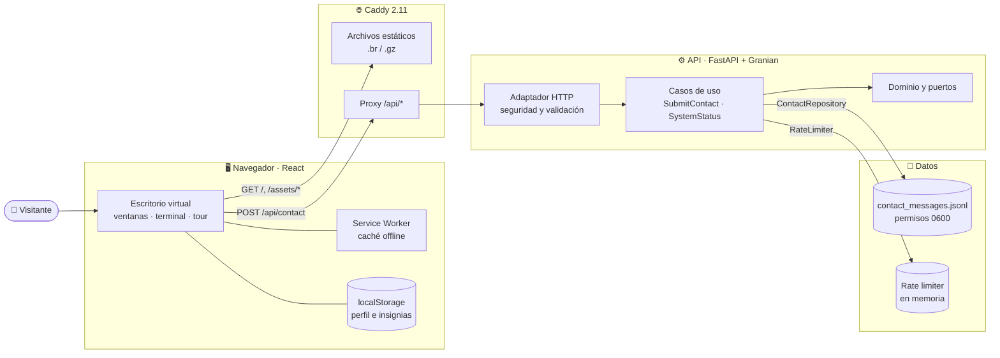

### 2. Recorrido del usuario

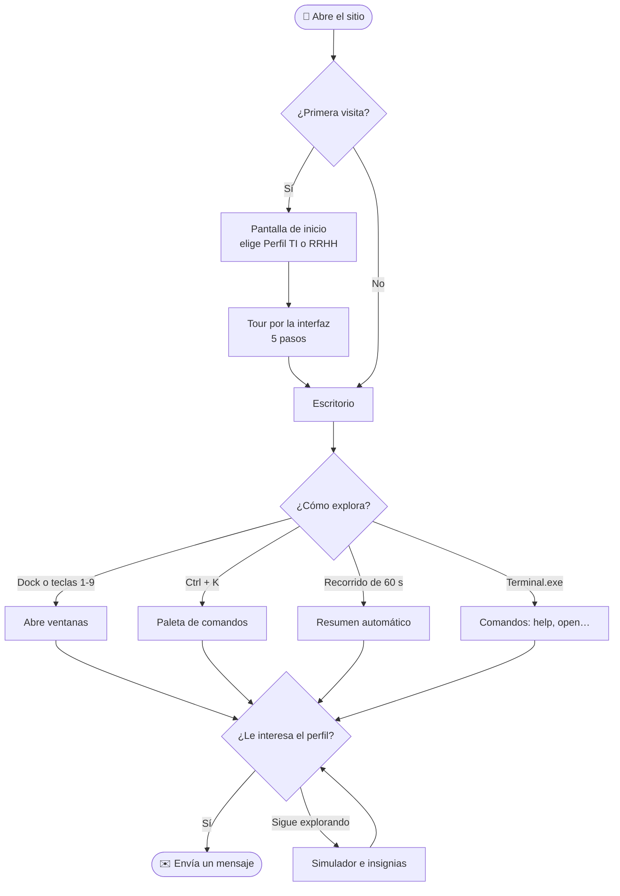

### 3. Envío de un mensaje de contacto (con casos de error)

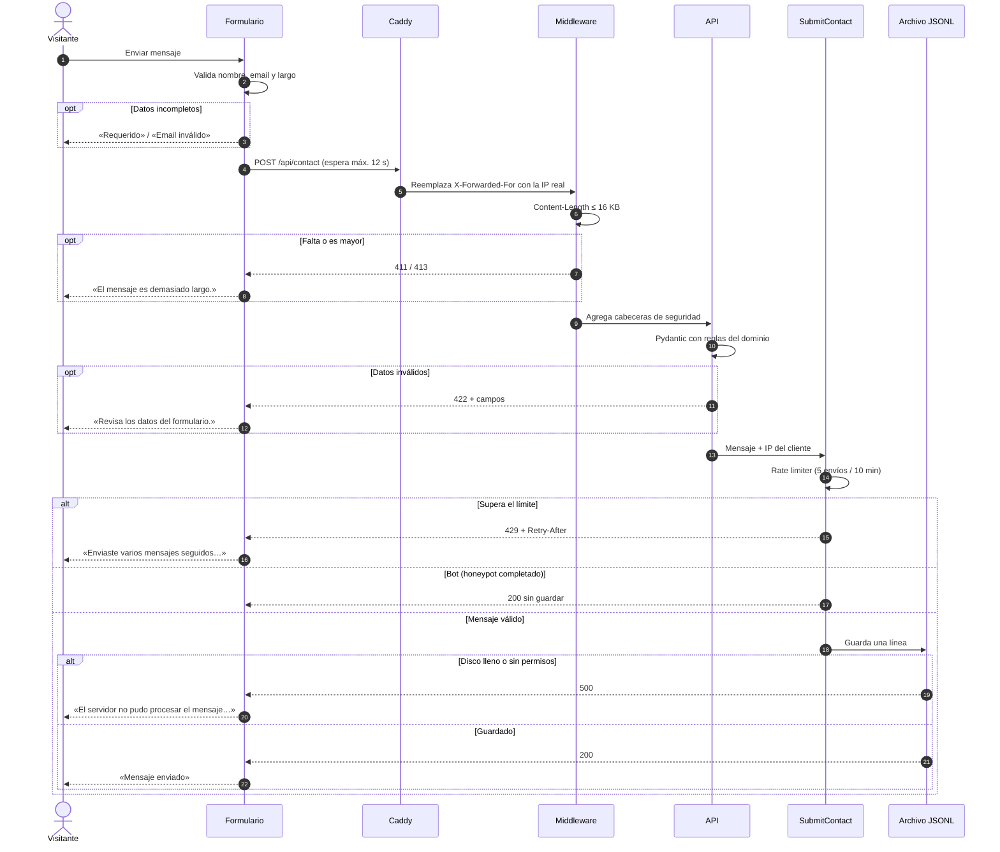

### 4. Una sola política de seguridad para dos servidores

La CSP y las cabeceras se definen una vez y se aplican igual en FastAPI y en Caddy. El hash del único script en línea se recalcula en cada build, y el CI falla si la versión del repositorio quedó desactualizada.

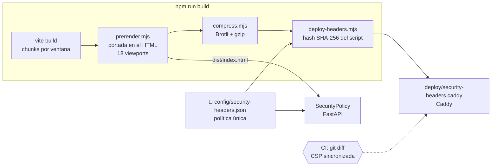

### 5. Modelo de datos

No hay base de datos. El servidor guarda un registro por línea en un archivo JSONL, el rate limiter vive en memoria y las preferencias quedan en el navegador del visitante.

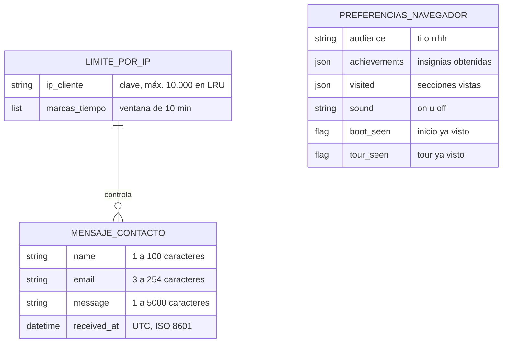

---

## 📋 Requisitos previos

### Para usar la aplicación (usuario final)

| Requisito | Detalle |
|---|---|
| 🌐 Navegador actual | Chrome, Edge, Firefox o Safari. Se adapta a celulares desde 320 px de ancho. |
| 🔑 Credenciales | No se necesitan: el sitio es público. |
| 📝 Datos | Solo si quieres escribir al autor: nombre, email y mensaje. |

### Para instalarla (perfil técnico)

| Requisito | Versión | Para qué se necesita |
|---|---|---|
| Docker + Docker Compose | Compose v2 con BuildKit | **Obligatorio con la opción Docker.** En Windows, Docker Desktop con WSL 2. |
| Node.js | 20.19+ o 22.12+ (el CI usa 24) | **Obligatorio sin Docker.** Compila el frontend. |
| Python | 3.13 o superior (Docker y CI usan 3.14) | **Obligatorio sin Docker.** Ejecuta la API. |
| uv | 0.13.7 | Opcional. Solo para regenerar los lockfiles de Python. |
| Caddy | 2.11 o superior | Opcional. Solo para un despliegue en servidor propio sin Docker. |
| Dominio con DNS apuntando al servidor | — | Opcional. Solo para HTTPS automático en producción (puertos 80 y 443 abiertos). |

> [!TIP]
> Activa `ENABLE_HSTS=1` solo cuando el sitio ya responda por HTTPS con tu dominio. HSTS obliga a los navegadores a usar HTTPS durante un año, así que activarlo antes de tiempo puede dejar el sitio inaccesible.

---

## 🚀 Instalación

### Paso 1 · Configurar variables de entorno

```bash
cp .env.example .env
```

Ninguna variable es obligatoria: sin `.env`, el stack arranca en `http://localhost`. Estas son las que lee Docker Compose:

| Variable | Obligatoria | Descripción | Por defecto |
|---|:---:|---|---|
| `SITE_ADDRESS` | — | Dirección que atiende Caddy. Con un dominio (`tudominio.cl`), Caddy obtiene HTTPS automáticamente. | `:80` |
| `HTTP_PORT` | — | Puerto HTTP del host. Cámbialo si el 80 está ocupado. | `80` |
| `HTTPS_PORT` | — | Puerto HTTPS del host (TCP y UDP para HTTP/3). | `443` |
| `ENABLE_HSTS` | — | `1` si el sitio se sirve solo por HTTPS. Caddy ya envía HSTS con `max-age=300` (ver `config/security-headers.json`); súbelo cuando HTTPS sea estable. | `0` |
| `CONTACT_RATE_LIMIT` / `CONTACT_RATE_WINDOW_S` | — | Mensajes por cliente y ventana en segundos. | `5` / `600` |
| `CONTACT_IPV6_PREFIX` | — | Las IPv6 comparten cupo por prefijo, para que rotar direcciones no evada el límite. | `64` |
| `CONTACT_GLOBAL_LIMIT` | — | Tope de mensajes por hora entre todos los visitantes (`429` al superarlo). | `100` |
| `CONTACT_LOG_MAX_MB` | — | Tamaño máximo del archivo de mensajes (`503` al superarlo). | `50` |
| `CONTACT_RETENTION_DAYS` | — | Los mensajes más antiguos se borran solos (al arrancar y una vez al día). `0` lo desactiva. | `365` |
| `CONTACT_NOTIFY_WEBHOOK` | — | URL `https` que recibe un aviso (sin datos personales) por cada mensaje nuevo. Vacío = desactivado. | vacío |
| `MIN_FREE_DISK_MB` | — | Espacio libre mínimo para que `/api/status` responda `ok`. | `100` |

<details>
<summary><b>Variables del backend</b> (ejecución sin Docker; la imagen ya trae valores para contenedores)</summary>

| Variable | Obligatoria | Descripción | Por defecto |
|---|:---:|---|---|
| `APP_ENV` | — | `development` activa recarga automática, `/docs` y CORS para Vite. | `production` |
| `HOST` / `PORT` | — | Dirección de escucha. Usa `0.0.0.0` solo detrás de un proxy o firewall. | `127.0.0.1` / `8000` |
| `CORS_ORIGINS` | — | Orígenes extra permitidos, separados por coma. | vacío |
| `TRUST_PROXY` | — | `1` para tomar la IP del cliente desde `X-Forwarded-For` (solo detrás de un proxy confiable). | desactivado |
| `FORWARDED_ALLOW_IPS` | — | Proxies confiables (IPs o CIDR). Usa `*` solo si el proxy sobrescribe la cabecera, como Caddy. | `127.0.0.1` |
| `CLIENT_IP_HEADER` | — | Cabecera de un CDN con la IP real, por ejemplo `cf-connecting-ip`. Requiere `TRUST_PROXY=1`. | vacío |
| `ENABLE_HSTS` | — | `1` envía `Strict-Transport-Security`. | desactivado |
| `CONTACT_LOG` | — | Archivo donde se guardan los mensajes. | `backend/contact_messages.jsonl` |
| `FRONTEND_DIST` | — | Carpeta del build del frontend. | `frontend/dist` |
| `SECURITY_HEADERS_FILE` | — | Política de cabeceras HTTP. | `config/security-headers.json` |

</details>

### Paso 2 · Ejecutar

<details open>
<summary><b>Opción A · Docker (recomendada)</b></summary>

```bash
docker compose up -d --build
```

Abre **http://localhost** (o `https://tudominio.cl` si configuraste `SITE_ADDRESS`).

```bash
docker compose ps                                          # estado y healthchecks
docker compose logs -f web                                 # registro de accesos (Caddy)
docker compose exec api cat /data/contact_messages.jsonl   # mensajes recibidos
```

</details>

<details>
<summary><b>Opción B · Desarrollo local</b> (recarga automática)</summary>

**Terminal 1: backend**

```bash
cd backend
python -m venv .venv
source .venv/bin/activate              # Windows PowerShell: .venv\Scripts\Activate.ps1
pip install --require-hashes -r requirements-dev.lock
APP_ENV=development python -m app      # Windows PowerShell: $env:APP_ENV="development"; python -m app
```

**Terminal 2: frontend**

```bash
cd frontend
npm install
npm run dev
```

Abre **http://localhost:5173**. Vite redirige `/api` a `http://localhost:8000`, y la documentación de la API queda en `http://localhost:8000/docs`.

</details>

<details>
<summary><b>Opción C · Artefacto de producción sin Docker</b></summary>

```bash
cd frontend && npm ci && npm run build      # genera frontend/dist
cd ../backend && pip install --require-hashes -r requirements.lock
python -m app                               # producción por defecto
```

Abre **http://localhost:8000**: FastAPI sirve la API y el build compilado. Si quieres Caddy delante, sigue las instrucciones del encabezado de [`deploy/Caddyfile`](deploy/Caddyfile).

</details>

### Cómo funciona el acceso

- **No hay usuarios ni contraseñas.** El sitio es público y no tiene login, roles, recuperación de contraseña ni MFA. Por lo mismo, no hay credenciales que configurar ni que cambiar.
- **Quién ve los mensajes:** solo quien tiene acceso al servidor. El archivo se crea con permisos `0600` (solo lo lee el usuario del proceso), y en Docker vive en el volumen `contact-data`, que sobrevive a reconstrucciones.
- **Si falta configuración:** la API arranca con valores seguros (escucha solo en `127.0.0.1`, sin `/docs` y sin CORS externo). Si en producción falta el build del frontend, la portada responde `503` con un mensaje que indica ejecutar `npm run build`, y `/api/status` informa `degraded`.
- **Límites de seguridad:** 5 mensajes cada 10 minutos por IP (las IPv6 agrupadas por /64), 100 mensajes por hora en total, archivo de mensajes de 50 MB como máximo y cuerpo de 16 KB. El contador vive en memoria, por eso la API corre con **1 worker**.
- **Retención:** los mensajes se borran a los 12 meses (`CONTACT_RETENTION_DAYS`).

---

## 📖 Manual de uso

**Paso 1 · Ingresar.** Abre el sitio. La primera vez aparece una pantalla de arranque que pregunta *«¿Cómo quieres explorar este portafolio?»*. Elige **Perfil TI** si buscas detalle técnico o **Perfil RRHH** si prefieres lenguaje de negocio. Puedes cambiarlo después desde la barra superior.

**Paso 2 · Seguir el tour.** Un tour de 5 pasos muestra las partes del escritorio. Avanza con **Siguiente**, vuelve con **Atrás**, cierra con **Saltar tour** o termina con **¡Listo!**. Para repetirlo, pulsa la tecla `?`.

**Paso 3 · Explorar las secciones.** Cada ícono del dock inferior abre una ventana: **Sobre mí**, **Para RRHH**, **Skills**, **Proyectos**, **Experiencia**, **Educación**, **Certificaciones**, **Contacto** y **Terminal.exe**. También puedes usar las teclas `1` a `9` (se pueden desactivar desde `Ctrl` + `K` → «Desactivar atajos de una tecla»). El CV, el simulador y las insignias se abren desde el núcleo **CORE**, la paleta o la terminal. Las ventanas se arrastran, se minimizan, se maximizan y se cierran con los botones de su barra o con `Esc`.

**Paso 4 · Ver el resumen rápido.** En la portada, pulsa **Recorrido de 60 s** para un resumen automático. Con **Ficha para RRHH** (perfil RRHH) o **Ver proyectos** (perfil TI) vas directo a lo principal, y con **Ver CV** abres el currículum para leerlo o descargarlo.

**Paso 5 · Buscar.** Pulsa el ícono de lupa o `Ctrl` + `K` y escribe, por ejemplo, «contacto», «logros» o «simulador». Usa las flechas para elegir y `Enter` para abrir.

**Paso 6 · Probar el simulador.** Abre **Simulador** desde la paleta o el núcleo **CORE**. Mueve **Hilos en paralelo (threads)**, activa **Caché de consultas** e **Índices en base de datos**, y pulsa **Ejecutar batch**. El reto es bajar el proceso a 10 minutos o menos.

**Paso 7 · Escribir al autor.** En **Contacto**, completa **Nombre**, **Email** y **Mensaje**, y pulsa **Enviar mensaje**. Si todo sale bien verás *«Mensaje enviado»*, y con **Enviar otro mensaje** puedes escribir de nuevo.

| Si ves este mensaje… | Qué hacer |
|---|---|
| «Requerido» o «Email inválido» | Completa el campo marcado en rojo o corrige el email (ejemplo: `nombre@empresa.com`). |
| «Revisa los datos del formulario.» | El servidor rechazó algún campo. Revisa los que aparecen marcados con «Revisa este campo». |
| «El mensaje es demasiado largo.» | Acórtalo. El máximo es de 5000 caracteres; el contador aparece al acercarte al límite. |
| «Enviaste varios mensajes seguidos. Podrás volver a escribir en unos N min.» | Espera los minutos indicados. Hay un límite de 5 mensajes cada 10 minutos. |
| «El servidor tardó demasiado en responder. Intenta de nuevo.» | La respuesta tardó más de 12 segundos. Reintenta en un momento. |
| «Sin conexión con el servidor. Revisa tu internet e intenta de nuevo.» | Verifica tu conexión y vuelve a pulsar **Enviar mensaje**. |
| «El servidor no pudo procesar el mensaje. Intenta de nuevo en unos minutos.» | Es un problema del servidor. Si se repite, escribe por LinkedIn o email (íconos al pie del formulario). |
| «Esta sección no se pudo mostrar.» | Pulsa **Reintentar**. Si dice «Revisa tu conexión», es un problema de red. |
| «Algo salió mal cargando el portafolio.» | Pulsa **Recargar página**. |

> [!TIP]
> En la **Terminal.exe**, escribe `help` para ver todos los comandos. Prueba `open proyectos`, `rrhh` o `recorrido`. Tu avance aparece en el trofeo de la barra superior; desde **Insignias** puedes empezar de cero con **Reiniciar progreso**.

---

## 🔒 Seguridad

| Riesgo | Cómo se mitiga |
|---|---|
| Inyección de scripts (XSS) | CSP con `script-src 'self'` más el hash SHA-256 del único script en línea, nunca `'unsafe-inline'` para scripts. `object-src 'none'` y `base-uri 'self'`. Los estilos sí permiten `'unsafe-inline'` porque Framer Motion anima atributos `style`. |
| Clickjacking | `X-Frame-Options: DENY` y `frame-ancestors 'none'`. |
| Spam y bots | Campo honeypot invisible (`website`): si se completa, se responde `200` pero no se guarda nada. Además, límite de 5 envíos cada 10 minutos por IP (IPv6 agrupada por /64), cupo global de 100 por hora con `429` y `Retry-After`, y tope de 50 MB para el archivo de mensajes. |
| Evadir el límite falsificando la IP | La IP se toma del último salto no confiable de `X-Forwarded-For`, y Caddy sobrescribe esa cabecera. Una cabecera de CDN solo se acepta si se configura explícitamente. |
| Cuerpos enormes (agotar memoria) | Sin `Content-Length` se responde `411`, y sobre 16 KB se responde `413`, antes de leer el cuerpo. |
| Texto engañoso o corrupto | Se eliminan los caracteres de control y de dirección bidi. El emoji y los saltos de línea se conservan. |
| Exposición de datos personales | El archivo se crea con permisos `0600`, el log nunca incluye el contenido del mensaje y la API responde con `Cache-Control: no-store`. |
| Superficie expuesta | `/docs` y `/openapi.json` solo existen en desarrollo. CORS se limita al origen de Vite en desarrollo. Cualquier `/api/*` desconocido devuelve JSON `404`/`405`. Caddy quita la cabecera `Server`. |
| Lectura de archivos fuera del build | Las rutas se resuelven con `resolve()` + `is_relative_to`, y solo se sirven extensiones permitidas. Caddy responde `404` a `*.md`, `*.br` y `*.gz`. |
| Contenedor comprometido | La API (uid 10001) y Caddy (uid 10002) corren como usuarios sin privilegios; la API no publica puertos al host. Ambos contenedores usan sistema de archivos de solo lectura, `cap_drop: ALL`, `no-new-privileges` y límites de 1 CPU y 256 MB. |
| Dependencias alteradas | Python se instala con `--require-hashes`. El CI ejecuta `pip-audit` y `npm audit`, y verifica que los lockfiles estén al día. |
| Navegación sin cifrar | Caddy envía HSTS con arranque gradual (`max-age=300`) y obtiene HTTPS automático al configurar un dominio. |
| Datos personales en mensajes | Aviso de uso bajo el formulario, borrado automático a los 12 meses y avisos por webhook sin datos personales. |

---

## ✅ Calidad y pruebas

```bash
# backend/
python -m pytest     # 137 pruebas: 62 unitarias + 75 de integración HTTP
ruff check .         # lint de Python (incluye reglas de seguridad tipo bandit)

# frontend/
npm run lint         # oxlint con cero advertencias permitidas
npm run build        # bundle + pre-render (verifica 18 viewports) + Brotli/gzip + CSP
```

Las pruebas cubren las reglas del dominio (limpieza de texto y validación de email), los casos de uso con dobles de prueba, el rate limiter (incluida la rotación de IPv6 y el cupo global), el honeypot, los intentos de falsificar la IP, la retención y el webhook de avisos, las cabeceras de seguridad, la CSP con hash, la entrega de archivos precomprimidos, ETag y `304`, el path traversal y los `404` honestos.

El CI ([`.github/workflows/ci.yml`](.github/workflows/ci.yml)) ejecuta todo esto en Linux, macOS y Windows en cada push a `main` y en cada pull request, con las Actions y las imágenes base fijadas por SHA y digest. Audita ambos lockfiles de Python. Después construye el stack Docker y hace un smoke test a través de Caddy (incluye el PDF del CV, HSTS, logs de acceso y que Caddy no corra como root). Dependabot propone actualizaciones semanales.

---

## 📁 Estructura del proyecto

```text
.
├── backend/                 API en Python (FastAPI + Granian)
│   ├── app/
│   │   ├── domain/          Entidades, reglas de validación y puertos (sin dependencias)
│   │   ├── application/     Casos de uso: SubmitContact y SystemStatus
│   │   ├── adapters/        Entrada HTTP (rutas, seguridad, proxy, SPA) y salida (JSONL, rate limiter)
│   │   ├── config.py        Configuración desde variables de entorno
│   │   └── main.py          Raíz de composición: create_app()
│   └── tests/               Pruebas unitarias e integración
├── frontend/                SPA en React + Vite + Tailwind
│   ├── src/
│   │   ├── app/             Gestor de ventanas, contextos, layout y ErrorBoundary
│   │   ├── components/      Barra superior, dock, ventana flotante, portada y fondo
│   │   ├── windows/         Contenido de cada ventana (carga bajo demanda)
│   │   ├── overlays/        Paleta de comandos, tours, menú CORE e insignias
│   │   ├── services/        Cliente HTTP de la API de contacto
│   │   ├── data/            Textos del portafolio (perfil TI y RRHH)
│   │   ├── lib/             Utilidades: almacenamiento, sonido, focus trap
│   │   └── styles/          Tema, fuentes y colores
│   ├── public/              Fuentes, imágenes, service worker y robots.txt
│   └── scripts/             Post-build: pre-render, compresión y CSP para Caddy
├── config/                  Política única de cabeceras de seguridad
├── deploy/                  Caddyfile y cabeceras generadas para Caddy
├── docs/
│   ├── auditoria/           Auditorías técnicas y propuestas (histórico)
│   └── screenshots/         Capturas de este README
├── .github/workflows/       Pipeline de CI
├── Dockerfile               Multi-stage: frontend → dependencias → api / web
└── docker-compose.yml       Stack de producción: Caddy + API
```

---

## ❓ Preguntas frecuentes

<details>
<summary><b>¿El sitio guarda o modifica mis datos?</b></summary>

Solo guarda lo que escribes en el formulario de contacto (nombre, email, mensaje y fecha), en un archivo privado del servidor. Tus preferencias e insignias quedan en tu propio navegador (`localStorage`) y no se envían. El sitio no usa cookies ni servicios de analítica de terceros.

</details>

<details>
<summary><b>¿Pueden usarlo varias personas a la vez?</b></summary>

Sí. Es un sitio público y cada visitante tiene su propio progreso en su navegador. La única restricción compartida es el límite de mensajes por IP, y personas que salen a internet con la misma IP (por ejemplo, una oficina) comparten ese límite.

</details>

<details>
<summary><b>No arranca o veo «El frontend no está compilado»</b></summary>

Sin Docker, ejecuta `npm run build` en `frontend/` antes de `python -m app`. Con Docker, revisa `docker compose ps`: el contenedor `web` espera a que `api` esté *healthy*. Si el puerto 80 está ocupado, define `HTTP_PORT=8080` en `.env` y abre `http://localhost:8080`.

</details>

<details>
<summary><b>Olvidé la contraseña, ¿cómo entro?</b></summary>

No hace falta: el sitio no tiene cuentas ni contraseñas. Para leer los mensajes recibidos necesitas acceso al servidor, por ejemplo `docker compose exec api cat /data/contact_messages.jsonl`.

</details>

<details>
<summary><b>Me aparece «Enviaste varios mensajes seguidos»</b></summary>

Alcanzaste el límite de 5 mensajes en 10 minutos. El propio mensaje indica cuántos minutos esperar. El contador se reinicia si se reinicia la API, porque vive en memoria.

</details>

---

## 🔭 Limitaciones conocidas y próximos pasos

| Hoy | Evolución propuesta |
|---|---|
| El rate limiter vive en memoria: obliga a 1 worker y se reinicia con la API. | Un adaptador `RateLimiter` sobre Redis para escalar horizontalmente sin tocar el dominio. |
| Los mensajes se guardan en un archivo JSONL y se leen por consola. No hay aviso al recibirlos. | Un adaptador que además notifique por email, o un repositorio sobre PostgreSQL con un panel de lectura protegido. |
| El frontend se valida con lint y build (incluida la verificación de layout), pero no hay pruebas E2E automáticas en el CI. | Incorporar al CI el script de Playwright que ya existe en `docs/auditoria/e2e.mjs`. |
| Los textos del portafolio están en el código (`frontend/src/data/`): cambiarlos requiere un nuevo build. | Moverlos a archivos de contenido (JSON o Markdown) editables sin tocar componentes. |
| La interfaz está solo en español. | Una capa i18n reutilizando la separación actual entre perfiles TI y RRHH. |
| El contenedor `web` (Caddy) usa el usuario por defecto de la imagen oficial. | Definir un usuario sin privilegios también para Caddy, manteniendo `NET_BIND_SERVICE`. |
| El repositorio no declara una licencia. | Agregar un archivo `LICENSE` que indique cómo puede reutilizarse el código. |

---

<div align="center">

**Desarrollado por [Maximiliano Caniullan](https://github.com/maximiliano-andres)**

[](https://github.com/maximiliano-andres)
[](https://www.linkedin.com/in/maximiliano-andres)
[](mailto:max.andres1995@outlook.com)

<sub>Backend en Python · Arquitectura hexagonal · Seguridad web · Optimización de rendimiento · React · Docker y CI/CD</sub>

</div>
